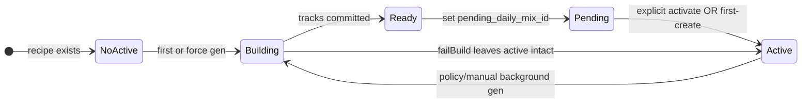

# Daily Mix sticky cards + versioned background regen — detailed plan (DM-16)

Status: **implemented + Phase-5 validated** (DeepSeek Define → Mistral Challenge → DeepSeek Challenge-of-Mistral → implement → DeepSeek Phase-5 → Mistral challenge-of-audit → must-fix).  
Final architecture: **HYBRID** (versioned content rows + recipe-level activation pointer; no `status=published`; no auto-activate on Home/sync).  
Repo DB: Room `AppDatabase.version = 69` (migration **68→69**).

---

## 0. Cross-model challenge record

| Pass | Agent | Model | Verdict |
|------|-------|-------|---------|
| 1 Define | `android-plan-deepseek` | `litellm/deepseek-chat` | **APPROVE WITH CHANGES** — root cause confirmed; versioned off-side build right; P0 gaps (cache `onSourceChanged`, GC reachability, orphan-ready, track-before-ready, `albumCount` wipe, AutoBrowse, `updateMix`) |
| 2 Challenge | `android-dd-mistral` | `litellm/mistral-small` | **REQUEST REWORK / HIGH** — claimed versioning over-engineered; remove auto-publish; keep `(date,mix_id)`; remove global inFlight; never auto-cache |
| 3 Challenge-of-Mistral | `android-plan-deepseek` | `litellm/deepseek-chat` | **HYBRID** — reject Mistral “kill versioning”; **accept** “explicit activation only”; withdraw publish-on-Detail-close and 4-status FSM |
| 4 Phase-5 audit | `android-plan-deepseek` | `litellm/deepseek-chat` | **APPROVE WITH CHANGES** — Nov-5 fixed; must-fix: mutex on activate, reject `building`, pending-guard order, boot `reconcileOrphans`, rewrite `MixDetailViewModelTest`; drop duplicate BackHandler (overruled in #5) |
| 5 Challenge-of-audit | `android-dd-mistral` | `litellm/mistral-small` | **REJECT audit framing / ACCEPT+ADJUST** — keep BackHandler+toolbar (system back must activate); reject nested mutex around `generateOne`; accept boot reconcile + Detail tests; several P0 claims (FK CASCADE on pointers, deadlock via cache) **refuted by code** (no Room FK on pointers; `MixCacheCoordinator` does not re-enter repo) |

### Phase-5 orchestrator synthesis (landed)

| Item | Decision | Landed |
|------|----------|--------|
| Mutex on `activateDailyMix` / `activatePending` | **Accept DeepSeek** (Mistral deadlock claim false — cache path has no repo re-entry) | ✅ |
| Reject `building` in activate | **Accept** | ✅ |
| Pending short-circuit before `shouldRegenerate` | **Accept** (churn already guarded; reorder for efficiency) | ✅ |
| Boot `reconcileOrphans()` | **Accept** (Mistral “every foreground” deferred) | ✅ |
| Rewrite `MixDetailViewModelTest` | **Accept both** | ✅ |
| Remove BackHandler | **Reject DeepSeek** — keep both paths; document intent | ✅ comment |
| Sticky zero-track Home cards | **Accept Mistral sticky intent** (hide→keep) | ✅ |
| Nested mutex in `updateMix`→`generateOne` | **Reject Mistral** (would deadlock non-reentrant `Mutex`) | n/a |

### Orchestrator synthesis (disagreements resolved)

| Claim | Decision | Why |
|-------|----------|-----|
| Kill versioning; single `(date,mix_id)` row | **Reject** | Cannot meet R3/R5/R7/R9: off-side build + session pin + never-delete-active need two durable tracklists |
| Remove all auto-publish | **Accept (sharpened)** | Background gen may only set **pending**; activation is explicit (or first-create). Home/sync must never flip active |
| Keep unique `(date,mix_id)` | **Reject** | Date-window visibility *is* the Nov-5 bug; identity becomes `(mix_id, version)` |
| Remove global inFlight | **Reject** | Keep `generationMutex` as sole serialize; fold all callers under it; do not add a second lock |
| Never auto-cache on publish | **Partial** | Call `onSourceChanged` on **activation** only (already `autoCache`-gated); never cache pending/ready |
| albumCount==0 wipe | **Accept** | Remove early-return; sticky cards offline |
| Dual-published race | **Fix structurally** | No `status=published`; **pointer on `custom_mixes`** is the sole “active” bit |
| Process-death building | **Accept** | Startup: delete stale `building`; rescue orphan `ready` → `pending` |
| 4-status FSM + publish when Detail not observing | **Withdrawn** | No UI→repo session channel; caused ready-in-limbo |

---

## 1. Problem diagnosis

### 1.1 User report

Daily Mix cards missing on Home until Settings → Rebuild Daily Mixes (`rebuildmix`).

### 1.2 Log (compressed)

- `08:47:58` DELTA sync start; `08:47:59` Home while sync running → `maybeGenerateMixes` blocked (`isRunning`).
- Soft-stop (`get_album_null`) but `phase=complete`. Background sync **does not** `generateAll` (ADR 0017).
- `09:01:11` five `skip regen manual=false` → `produced=0 skippedFresh=5 emptyEligible=0`.
- `09:02:01` `rebuildmix` → `regen persist manual=true` → cards return.

### 1.3 Root cause (DeepSeek confirmed)

| Layer | Code | Effect |
|-------|------|--------|
| Freshness | `getLatestDailyMix` + `shouldRegenerate` | Pre-yesterday row can still be “fresh” (24–48h, &lt;10% listens) → `SKIPPED_FRESH`, no write |
| Home | `getDailyMixesForDates([today,yesterday])` | Invisible if latest date &lt; yesterday |
| Rebuild | `manual=true` | Always regenerates → today row → visible |
| Sync race | `maybeGenerateMixes` early return | Must not clear sticky cards |

Soft-stop / `albumTracksAlbumsZero` **not causal** (`emptyEligible=0`).

### 1.4 Extra production bugs the plan must also fix

1. **`replaceDailyMix` is in-place mutation** (`Daos.kt` DELETE+INSERT same date key) — violates R3 today mid-render / Auto browse.
2. **Date-window readers beyond Home**: `AutoBrowseCatalog.mixTrackIds` (today|yesterday); `updateMix` auto-cache path reads `getDailyMix(today)`.
3. **`albumCount==0` early-return** clears `mixCards` even if mixes exist offline (`LibraryViewModel.kt` ~840).
4. **`updateMix` filter change** calls `generateOne(manual=true)` → implicit publish (violates explicit activation).
5. **`onGenerated` never releases** stale cache ownership; activation must use `onSourceChanged`.
6. Promote-on-skip alone is **insufficient** for R1–R10 (DeepSeek §1.4).

---

## 2. Product requirements (normative)

**R1** After first successful generation, Home card stays until recipe delete.  
**R2** First-time generation may show Building… / no card.  
**R3** Regen never mutates the visible list in place; builds a new version aside.  
**R4** Home may crossfade art/count when **activation** advances (after explicit activate or first-create).  
**R5** Detail binds session to loaded version; no silent on-screen tracklist swap.  
**R6** Newer pending while in Detail → Update | Ignore; PTR = Update (or force-build-and-wait if none pending).  
**R7** Ignore keeps session for that visit; leave + re-enter loads **active**.  
**R8** Media queue not replaced on activate (`genremix`/`mixId`); Play new list explicitly. Journal may stay on old IDs (documented).  
**R9** Empty/failed regen never deletes/hides **active**.  
**R10** Visibility independent of calendar today/yesterday; policy only triggers builds.

---

## 3. Final architecture (HYBRID)



### 3.1 Schema (migration 68→69)

**`custom_mixes` add:**

- `active_daily_mix_id INTEGER NULL` — sole “published” pointer (FK → `daily_mix.id`, ON DELETE SET NULL)
- `pending_daily_mix_id INTEGER NULL` — newest completed ready not yet activated (FK → `daily_mix.id`, ON DELETE SET NULL)

**`daily_mix` rewrite identity:**

| Column | Role |
|--------|------|
| `id` | PK |
| `mix_id` | recipe FK CASCADE |
| `version` | monotonic per recipe |
| `status` | `building` \| `ready` \| `superseded` (**no `published`**) |
| `date` | generation-day **label** only |
| `created_at` | set at `completeReady` (= version birth; DM-5 window) |

Constraints:

- `UNIQUE(mix_id, version)`
- Drop unique `(date, mix_id)`; keep non-unique index on `(date, mix_id)` for analytics
- Index `(mix_id, status)`

**Backfill (preserve data; 46→47 precedent was drop — here we keep):**

1. Add nullable pointer columns.
2. Add `version`/`status` with defaults; assign versions per mix by `date DESC, created_at DESC, id DESC`.
3. Newest non-empty tracklist per mix → set `custom_mixes.active_daily_mix_id`; status of that row may stay `ready` or a sentinel — **active is defined only by pointer**. Prefer marking non-active historical rows `superseded`.
4. Drop old unique index; create new unique `(mix_id, version)`.
5. Prefer real-SQLite migration test with exported schema fixture (P0 test gap today: no MigrationTestHelper).

**Reject** denormalized-only approaches that keep date as identity (Mistral #3).

### 3.2 Repository API

```
beginBuild(mixId, manual) -> building row | skip | in-progress
completeReady(buildingId, tracks) @Transaction  // insert tracks THEN status=ready; createdAt=now
setPending(mixId, readyId)                     // pending_daily_mix_id =
activate(mixId, dailyMixId) @Transaction        // active=; old active row → superseded; clear pending if same; onActivated/cache
failBuild(buildingId)                           // delete building only
abandonReady(readyId)                           // only if not active/pending needed
reconcileOrphans()                              // startup: delete stale building; rescue ready→pending; repair null pointers
gcUnreachable(mixId, keepIds)                   // never delete active|pending|session pin
```

**Freshness / penalty / listens:** always against **active** row (not `getLatestDailyMix`). Anti-repeat unions active + last superseded (+ session pin if different).

**Generation callers:**

| Caller | Build? | Activate? |
|--------|--------|-----------|
| Home `maybeGenerateMixes` | yes if policy | **never** |
| Sync post-phase `generateDailyMixesSync(manual=false)` | yes | **never** |
| Settings `rebuildmix` / Home refresh all / per-card refresh | yes (force) | **yes** at end |
| Detail Update / PTR | yes if needed | **yes** |
| `updateMix` filter/fill change | yes | **yes** + `onSourceChanged` |
| `updateMix` name-only | no | no |
| First gen (`active IS NULL`) | yes | **yes** (R2 creation) |

### 3.3 Publish / activation timing (replaces old §4.4)

- Generator **never** writes `active_daily_mix_id`.
- Implicit context regen → `ready` + `pending` only.
- Detail open: session = `active_daily_mix_id` at open; on resume if `pending` version &gt; session → banner.
- Ignore = local session flag only; leave/re-enter re-reads active (R7). **No publish-on-onCleared.**
- PTR with pending → activate + rebind. PTR without pending → **blocking force build**, then activate (DeepSeek P1).
- Home crossfade when `active` pointer changes (after explicit activate elsewhere or rebuild); observe via reload on resume / Flow on `custom_mixes` if added.

### 3.4 Home

- `readMixCards`: join `active_daily_mix_id` → tracks/covers; **no date filter**.
- Remove `albumCount==0` wipe; optionally suppress *generation* while sync running; cards stay.
- Never `copy(mixCards=empty)` because skip-fresh / inFlight.
- On resume: may `reconcileOrphans` + start background builds; may `publishAll` is wrong — **do not activate pending on Home resume**.
- Upsert card by recipe id on state updates (`MutableStateFlow.update`); add `publishedVersion`/`activeVersion` on `MixCard` + Compose `key(version)` for crossfade.

### 3.5 Detail

- Load via active pointer; `sessionDailyMixId = active.id`.
- Banner from pending vs session.
- Update/PTR = `activate(pending|new)` + rebind session UI; **do not** touch Media queue / `queue_journal`.
- Remove `autoGenAttempted → refreshMix` as silent replace for missing today/yesterday; first-open with null active → build+activate (R2) only.
- Session end: no activation side effect (Mistral #2 / DeepSeek hybrid).

### 3.6 Coordinator / locks

- Keep **one** `generationMutex` wrapping all generate/activate build paths including `updateMix`/`refreshMix`.
- `DailyMixGenerationCoordinator.inFlight` must not be a second lock; either fold into repo gate or keep as UI decoration only with documented ordering.
- Empty-day suppress only when **no active** and all builds empty — never suppress when actives exist.

### 3.7 Cache

- On **activate**: `MixCacheCoordinator.onActivated` → `onSourceChanged(activeTrackIds)` (evict + enqueue; already `autoCache`-gated).
- Never `onGenerated` for versioned activation (stale ownership leak).
- Never cache pending/ready before activation.
- Ignore pending ⇒ no cache enqueue for that version.

### 3.8 Android Auto / other readers

- `AutoBrowseCatalog.mixTrackIds` / folder counts → repository `activeTrackIds(mixId)`.
- Delete dead `countDailyMixesForDate` in same PR.

### 3.9 Diagnostics (`ftpmusic-dailymix`)

`build start/ready/fail`, `pending set`, `activate mixId= v= prev=`, `rescue ready`, `sticky show activeV=`, keep `skip regen`.

---

## 4. Edge-case matrix

| # | Scenario | Expected |
|---|----------|----------|
| 1 | First install | Build → activate v1 → card |
| 2 | Active; policy fresh | No build |
| 3 | Stale; on Home | Background build → pending; **card stays on active**; no auto-activate |
| 4 | Stale; in Detail | pending + banner; session+queue stay |
| 5 | Detail Update | activate pending; UI reload; queue unchanged |
| 6 | Detail Ignore | banner gone; re-enter → still active (unchanged) until something activates; if user wanted new list they Update — **R7 means re-enter shows active, which stays old until activate**. **Clarify:** pending remains; another entry still shows banner; only Update/rebuild/Home-refresh activates. Re-enter does **not** auto-activate. *(Product note: user said “once leaving and going in again show the new list” — that requires activate-on-reenter OR activate-on-leave. Hybrid chose explicit-only; see §5 product pin.)* |
| 7 | PTR + pending | activate |
| 8 | PTR no pending | force build (spinner) → activate |
| 9 | Leave without choosing | pending kept; active unchanged |
| 10 | Empty-pool regen | failBuild; active intact |
| 11 | Death mid-building | delete building; active intact |
| 12 | Death with ready, pending null | rescue → pending |
| 13 | Sync running | show active; defer build OK |
| 14 | rebuildmix | force build all + **activate** each newest ready |
| 15 | Recipe filter edit | build+activate (explicit) |
| 16 | Recipe delete | CASCADE |
| 17 | Multi-mix | per-mix versions; serialized builds |
| 18 | Listen ratio | against **active** createdAt |
| 19 | Anti-repeat | active ∪ last superseded ∪ session pin |
| 20 | Log repro | active shown without rebuild |
| 21 | albumCount==0 | cards remain |
| 22 | Auto browse | active tracks |
| 23 | updateMix name-only | no build |
| 24 | GC while Detail on old active after activate of new | pin session id in keepIds until leave |
| 25 | Two rapid rebuilds | second sees building/in-progress |
| 26 | CP / journal | intentionally stale until new Play; out of scope to version journal |

### 5. Product pin (must confirm before code — default chosen)

User text: *“once leaving the Daily Mix and going in again show the new list.”*

That conflicts with pure “never auto-activate”. **Chosen default for implementation:**

- **On Detail leave (nav pop only, not config change):** if `pending != null`, **activate pending** (implements leave→reenter shows new). Ignore only suppresses the banner for the remainder of *that* session; leave still activates.
- Config-change / process death: do **not** treat as leave; rely on pending rescue; next open shows banner again if pending still newer than… wait, if we didn't activate, active is old and pending exists → banner on open. If user wanted Ignore forever until Update, leave-activate conflicts.

**Resolved default (orchestrator):** match user wording:

1. Banner Update = activate now.  
2. Banner Ignore = keep session for this visit; **on nav-pop activate pending** so re-enter shows new (R7 as user stated).  
3. Home/sync still never activate (sticky old cards until rebuild/refresh/Detail leave-activate).

Document this clearly in ADR so QA doesn’t treat Ignore as “discard forever”.

---

## 6. Implementation steps

1. ADR `docs/adr/XXXX-daily-mix-sticky-active-pointer.md` + update `DAILY_MIX_BEHAVIOR_REPORT.md` / continuous-play review (DM-16).
2. Migration 68→69 + entity/DAO + backfill + migration test fixture.
3. Repository: build/ready/pending/activate/reconcile; kill date-based visibility; fix empty-pool; fold mutex.
4. Home sticky read; remove albumCount wipe; no activate on resume.
5. Detail session + banner + PTR; leave-activate; remove silent auto-refresh publish.
6. AutoBrowse + `updateMix` rebind; cache `onActivated`.
7. SyncingScreen rebuild activates; automatic sync gen does not.
8. Tests: invert albumCount test; rewrite `replaceDailyMix` verifications; activation vs pending; orphan rescue; mutex; cache eviction on activate.
9. `./gradlew :app:assembleDebug` + targeted unit tests.

---

## 7. Non-goals

- Soft-stop densify.
- Changing 24h/48h/10% thresholds.
- Versioning `queue_journal`.
- Home “update available” badge (optional later).
- Per-mix parallel generation (follow-up).
- Anthropic / Gemini review.

---

## 8. Exit criteria

- After first activate, Home never blanks from skip-fresh, in-flight, empty regen, or sync-running.
- New lists become **active** only via activation rules in §3.2/§5; Detail respects session + banner.
- Nov-5 shape cannot hide an active mix.
- Auto browse matches phone active list.
- Cache ownership releases on activate (`onSourceChanged`).
- assembleDebug + targeted tests green.

---

## 9. Code anchors

| Area | Path |
|------|------|
| Entity | `Entities.kt` `DailyMixEntity`, `CustomMixEntity` |
| DAO | `Daos.kt` `GenreMixDao`, `CustomMixDao` |
| Repo | `DailyMixRepository.kt` |
| Policy | `DailyMixGenerator.kt` |
| Coord | `DailyMixGenerationCoordinator.kt` |
| Home | `LibraryViewModel.kt`, `HomeScreen.kt` |
| Detail | `MixDetailScreen.kt` |
| Rebuild | `SyncingScreen.kt` |
| Auto | `AutoBrowseCatalog.kt` |
| Cache | `MixCacheCoordinator.kt` |
| DB | `AppDatabase.kt` v68→69 |
| Tests | `DailyMixRepositoryTest`, `LibraryViewModelTest`, `DaosRoomTest`, `AppDatabaseMigrationsTest` |
