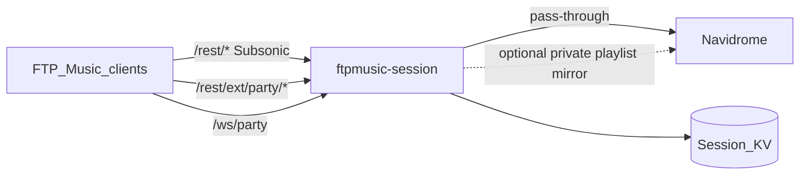

# Navidrome Session Sidecar — Transparent API Extension

Status: Exploration / design (Collab · Jam · Blend still **product OOS** until
reopened)  
Date: 2026-11-12  
Related: [`SPOTIFY_JAM_AND_FTPMUSIC_LOCAL_PARTY.md`](SPOTIFY_JAM_AND_FTPMUSIC_LOCAL_PARTY.md),
ADR-0010, ADR-0015, ADR-0067, ADR-0111, ADR-0153,
draft Navidrome [HTTPEndpoint #5045](https://github.com/navidrome/navidrome/pull/5045)  
Precedents: [Navimix](https://github.com/rohan-development/navimix),
[octo-fiesta](https://github.com/V1ck3s/octo-fiesta) (Subsonic proxy + enhance)

---

## 1. Verdict

A second process — **`ftpmusic-session`** — sits **in front of** Navidrome as a
transparent Subsonic gateway:

- Stock library / stream / playlist APIs **pass through** to Navidrome.
- **Party/Jam session SoT**, **KV**, and **WebSocket fanout** live in the
  sidecar with **atomic revision CAS**.
- FTP Music keeps **one base URL** (the gateway).
- Does **not** require Navidrome WASM inbound endpoints (#5045).
- Public contract is stable **`/rest/ext/party/*`** so a future in-process
  plugin can replace the sidecar without rewriting the Android client.

**Locked path:** sidecar = primary **server-side** Party control plane; optional
LAN mesh remains offline/LAN fallback; WASM plugin = later reimplementation of
the same HTTP+WS contract.

---

## 2. Architecture



| Path | Owner | Behavior |
|------|-------|----------|
| `/rest/ping`, `getLicense`, `search3`, `getAlbum`, `stream`, `download`, `getCoverArt`, `getPlaylist*`, `scrobble`, `savePlayQueue`, … | Gateway → ND | Streaming-safe reverse proxy; preserve query/body auth |
| `/rest/ext/party/*` | Gateway | Session CRUD, queue, transport intent, permissions (JSON) |
| `/ws/party` | Gateway | Auth’d push of `Delta` / `Welcome` after CAS commit |
| `/app`, ND web UI | Prefer **direct to ND** (or separate vhost) | Avoid coupling UI to gateway; mobile clients use gateway only |

Deploy: publish **only** the gateway port to clients; Navidrome listens on an
internal network.

---

## 3. Transparent Subsonic proxy

### 3.1 Requirements

| Requirement | Why |
|-------------|-----|
| Support **XML and JSON** (`f=json`) | Navimix lesson: JSON-only breaks many clients |
| Stream `stream` / `download` with **Range**, no full buffer | Large files / seek |
| Forward **all** query params and form bodies | Subsonic auth + OpenSubsonic extras |
| Reasonable idle timeouts on long streams; short timeouts on control | Avoid killing `stream` |
| Do not rewrite song/album ids | Client Dual/Room ids must match ND |

### 3.2 Pass-through algorithm

```text
on Request to /rest/{method} (not under /rest/ext/party):
  rewrite URL → {NAVIDROME_BASE}/rest/{method}{?query}
  copy method, headers (Host → ND host), body
  pipe response status/headers/body (flush streaming)
```

Health for ops (not Subsonic): `GET /healthz` → gateway up; optionally probe ND
`ping` with a service account (never expose that account to clients).

### 3.3 What the gateway must not “enhance” in v1

No merging external catalogs (unlike octo-fiesta/Navimix). Party is an **add-on
namespace**, not a rewrite of `search3`/`stream`. Keeps FTP Music behavior
identical for non-party paths.

---

## 4. Auth

### 4.1 Transparent ND credentials

Every Subsonic and party HTTP call carries normal Subsonic params (`u`, `v`,
`c`, plus `t`+`s` or `p` / JWT as ND supports). Gateway **never** stores
passwords as a user DB.

**Validate identity:**

1. On party route (or first request): proxy `getUser` (or `ping` + lightweight
   call) to ND with the same credentials.
2. Cache `{user → ok}` with short TTL (e.g. 60s) keyed by hash of auth material.
3. On ND 40/41-style auth failure: invalidate cache, return Subsonic-shaped or
   JSON 401 to party routes.

Password change: TTL expiry revalidates; forced logout can be “cache max 60s.”

### 4.2 Party membership

| Token | Issued when | Used for |
|-------|-------------|----------|
| ND Subsonic auth | Always | Prove user exists on ND |
| `memberToken` | `POST …/join` or create | WS + mutating party routes |
| Optional `partyPin` | Session create | Extra gate for join (LAN hostility) |

Mutating party routes require: valid ND user **and** membership (host or
guest). `memberToken` is bound to `sessionId` + `username`; rotate on rejoin.

### 4.3 WS auth

`GET /ws/party?session={id}&memberToken={t}` (or first message `Auth`). Reject
anonymous sockets. Heartbeat; miss N intervals → leave + CAS member remove.

---

## 5. KV schema and atomic CAS

### 5.1 Storage

| Phase | Store |
|-------|--------|
| v1 | SQLite file (single binary, ND-like ops) |
| Multi-instance | Redis + sticky WS or Redis pub/sub fanout |

Logical keys:

```text
party:session:{id}     → SessionDocument JSON + revision column
party:code:{joinCode}  → sessionId
party:member:{tokenHash} → { sessionId, username, role }
```

### 5.2 Session document

```text
SessionDocument {
  id:            string          // UUID
  joinCode:      string          // high-entropy short code
  hostUser:      string          // ND username
  revision:      int64           // monotonic
  permissions: {
    guestsCanControlPlayback: bool
    guestsCanReorder: bool
    guestsCanSkip: bool          // may fold into playback
  }
  members: [{
    memberId: string
    username: string
    displayName: string
    role: host|guest
    joinedAt: string
  }]
  queue: [{
    entryId: string              // server-issued; clients Remove/Move by this
    trackId: string              // ND song id
    title?, artist?, coverId?
    queuedBy: string             // username
    band?: CONTEXT|PRIORITY|LATE // optional hint for playback node
  }]
  transport: {
    state: playing|paused|stopped
    trackId?: string
    entryId?: string
    positionMs?: int64
    updatedAt: string
  }
  playbackNode: {
    deviceId: string
    lastSeen: string
  }
  playlistId?: string            // optional lossy ND export; NEVER SoT
  pinHash?: string
  createdAt, expiresAt, lastActivityAt: string
}
```

### 5.3 Atomic write path

```text
mutate(sessionId, expectedRevision, applyFn, clientTag?):
  BEGIN
    row = SELECT … WHERE id=? FOR UPDATE
    if row.revision != expectedRevision → CONFLICT
    next = applyFn(row.doc)
    next.revision = row.revision + 1
    next.lastActivityAt = now
    UPDATE … SET doc=?, revision=? WHERE id=? AND revision=expected
  COMMIT
  if conflict → 409 + full snapshot (no WS partial)
  else → WS broadcast Delta { revision, changes, clientTag? }
```

Rules:

- No read-modify-write outside the transaction.
- Guests never key Remove/Move on playlist index or Dual-local-only ids until
  server assigns `entryId` in `Delta`.
- Idempotent `clientTag`: if tag already applied at this or newer revision,
  return success + current snapshot (no double add).

### 5.4 TTL / GC

Scheduler (in-process ticker): expire sessions with `lastActivityAt` older than
configured idle (e.g. 4h); delete `party:code:*`; disconnect WS; optional ND
playlist delete if `playlistId` set.

---

## 6. REST contract `/rest/ext/party` (aligned with Local Party §7)

Canonical paths below. Local Party §7 used plugin id prefix
`/rest/ext/ftpmusic-jam/…`. **Sidecar + future plugin both expose `/rest/ext/party`.**
Optional alias: `/rest/ext/ftpmusic-jam/*` → same handlers for early sketches.

All party HTTP responses: JSON. Subsonic query auth params still required on
each call (transparent). Mutating bodies include `expectedRevision` unless noted.

| Method | Path | Actor | Behavior |
|--------|------|-------|----------|
| GET | `/rest/ext/party/health` | Any | `{ "ok": true, "version": "1", "ndReachable": bool }` — feature detect |
| POST | `/rest/ext/party/sessions` | Host (ND user) | Create; seed `queue[]` of trackIds; optional PIN; return `{ session, joinCode, memberToken }` |
| POST | `/rest/ext/party/sessions/{id}/join` | Guest | Body `{ joinCode?, pin? }`; return `{ session, memberToken }` |
| GET | `/rest/ext/party/sessions/{id}` | Member | Full snapshot; optional `?sinceRevision=` → 204 if unchanged |
| POST | `/rest/ext/party/sessions/{id}/queue` | Member | `{ op: add\|remove\|move, …, expectedRevision, clientTag? }` |
| POST | `/rest/ext/party/sessions/{id}/transport` | Permitted | `{ op: play\|pause\|skip\|seek, …, expectedRevision }` — updates **intent**; playback node applies Dual/Cast |
| PATCH | `/rest/ext/party/sessions/{id}/permissions` | Host | Permission toggles + `expectedRevision` |
| POST | `/rest/ext/party/sessions/{id}/playback-node` | Host device | Register/refresh `{ deviceId }` lease |
| POST | `/rest/ext/party/sessions/{id}/kick` | Host | `{ memberId, expectedRevision }` |
| DELETE | `/rest/ext/party/sessions/{id}` | Host | End; GC KV; optional playlist delete |
| GET | `/rest/ext/party/resolve` | Auth’d ND user | `?code=` → `{ sessionId, wsUrl }` (stable join; no IP in QR required) |

### 6.1 Queue op bodies

```text
add:    { op: "add", trackId, band?: "CONTEXT"|"PRIORITY", clientTag?, expectedRevision }
remove: { op: "remove", entryId, expectedRevision, clientTag? }
move:   { op: "move", entryId, toIndex, expectedRevision, clientTag? }
```

Server validates `trackId` via ND `getSong` (proxied) before CAS add; reject
unknown / unauthorized library tracks.

### 6.2 Transport semantics

Sidecar stores **intent** only. Host FTP Music registered as `playbackNode`:

1. Subscribes to WS (or polls GET snapshot).
2. On transport Delta → calls local `PlaybackManager` (Cast fence per Local
   Party §4.7).
3. Optionally POSTs position heartbeats into `transport.positionMs` (CAS or
   separate lease table to avoid fighting queue revisions — v1: include in
   transport CAS with high expectedRevision tolerance / separate `positionRev`).

**Guests never become Cast senders.**

### 6.3 Mapping from Local Party §7

| §7 (`ftpmusic-jam`) | Sidecar (`party`) |
|---------------------|-------------------|
| POST `…/sessions` | Same |
| POST `…/sessions/{id}/join` | Same |
| GET `…/sessions/{id}` | Same |
| POST `…/sessions/{id}/queue` | Same |
| POST `…/sessions/{id}/transport` | Same |
| PATCH `…/sessions/{id}/permissions` | Same |
| DELETE `…/sessions/{id}` | Same |
| (mesh resolve on phone) | GET `…/resolve?code=` on gateway |
| KV `jam:{id}` | `party:session:{id}` |

---

## 7. WebSocket protocol

Aligned with Local Party §5.2; server is always SoT (not phone host Dual).

```text
// server → client
Welcome { protocolVersion: 1, revision, sessionId, permissions, members[], queue[], transport, playlistId? }
Delta   { revision, changes[], clientTag? }
Reject  { reason, clientTag?, snapshot? }
Heartbeat

// client → server (optional; REST preferred for mutations so CAS stays one path)
// v1: WS is push-only; clients mutate via REST. Keeps one atomic pipeline.
Resync  { }  // server replies Welcome
```

**v1 decision (locked):** mutations **REST-only**; WS **push-only**. Avoids dual
writers and matches “atomic interaction” through one CAS entrypoint.

Latency targets (LAN/same DC): REST mutate → WS Delta **&lt; 100 ms** typical;
cross-internet depends on ND/gateway RTT.

---

## 8. Optional playlist mirror (lossy)

Default **off**. If enabled on create:

- Gateway (as host user) `createPlaylist` + private `updatePlaylist` on ND.
- Debounced track-id list sync after queue CAS (lossy: no entryId/bands).
- **Forbidden:** clients reading playlist as Remove/Move source or recovery SoT.
- On session end: delete playlist via ND API.
- Prefer **private** (Local Party P0: `public=true` leaks queue server-wide).

---

## 9. FTP Music client integration

### 9.1 Feature detect

```text
GET {baseUrl}/rest/ext/party/health?u=…&t=…&s=…&v=1.16.1&c=ftpmusic
→ 200 { ok: true }  ⇒ server party mode available
→ 404 / connection to raw ND without gateway ⇒ mesh-only / no server party
```

On login / server save: probe once; cache flag in `ServerConfig` extras.

### 9.2 Base URL

Users point the app at the **gateway** (e.g. `https://music.example.com` where
compose publishes `ftpmusic-session`). All existing `SubsonicApi` calls keep
working via pass-through.

### 9.3 Roles

| Role | App behavior |
|------|----------------|
| Host / playback node | Create session; register playback-node; apply transport+queue to Dual via serial mutator; Cast fence |
| Guest | Join; Search → Add via party queue API; mirror queue UI from snapshot/WS; **local player locked** in guest mode |

### 9.4 Offline / no gateway

Fall back to Local Party mesh design (phone WS) only if product still wants
LAN-only parties without sidecar — mutex: never two SoTs for one logical party.

---

## 10. Deployment sketch

```yaml
# illustrative compose fragment
services:
  navidrome:
    image: deluan/navidrome:latest
    # no host ports; only internal
    volumes: [ "nd-data:/data", "music:/music:ro" ]
  ftpmusic-session:
    image: ftpmusic/session:latest   # future
    environment:
      ND_BASE_URL: http://navidrome:4533
      KV_PATH: /data/session.db
      PARTY_IDLE_TTL: 4h
    ports: [ "4533:8080" ]           # clients see classic ND port or 443 via TLS terminator
    volumes: [ "session-data:/data" ]
```

TLS: terminate at Caddy/nginx in front of gateway; gateway may speak HTTP to
ND on internal Docker network.

Suggested Go layout (when implemented):

```text
ftpmusic-session/
  cmd/gateway/
  internal/proxy/
  internal/auth/
  internal/party/
  internal/kv/
  internal/ws/
  api/openapi.yaml
```

---

## 11. Migration: sidecar → Navidrome plugin

When #5045 (or equivalent) ships:

1. Keep **`/rest/ext/party`** paths identical.
2. Move CAS document store to plugin KVStore; WS may remain sidecar **or**
   poll-only if plugin cannot host inbound WS — prefer keep thin WS sidecar
   longer rather than degrade to poll.
3. FTP Music: same feature detect; ops remove proxy pass-through only if ND
   serves both library and ext routes on one port.
4. Contract version field in `health` / `Welcome.protocolVersion` for breaking
   changes.

---

## 12. Risks and mitigations

| Risk | Mitigation |
|------|------------|
| Stream proxy buffering | Streaming copy; disable response buffering; test Range |
| XML/JSON | Pass bytes; do not parse Subsonic bodies on pass-through |
| Auth cache stale | Short TTL; fail closed on ND errors |
| Horizontal scale | Sticky sessions or Redis KV + pub/sub |
| Attack surface | Rate-limit party + WS; PIN; membership tokens |
| Playlist dual-write confusion | Mirror off by default; doc forbids SoT use |
| Playback node offline | Transport intents queue in KV; apply on reconnect; or pause party |
| Split-brain mesh + sidecar | Single feature flag path; one SoT per party |

---

## 13. Cross-check vs Local Party P0s

| Local Party P0 | Sidecar compliance |
|----------------|-------------------|
| Dual+WS Resync as phone-mesh SoT | **Superseded when gateway present:** KV session + REST CAS is control SoT; Dual is **playback projection** on playback node only |
| Playlist not recovery/control SoT | Enforced (§8); mirror optional private only |
| Stable join via joinCode resolve | `GET /rest/ext/party/resolve` — QR carries code, not sticky IP:port |
| `public=true` privacy | Default no public export |
| Cast ↔ mutation fence | Remains on **host app** serial mutator when applying deltas |
| Cleartext token / QR | Prefer HTTPS gateway; membership token ≠ joinCode in QR if PIN used; short-lived memberToken |
| Guest MediaSession lock | Client requirement unchanged |
| Orphan playlist GC | Sidecar TTL end deletes mirrored playlist |
| entryId-only Remove/Move | Server-issued entryIds in document |

**Adjusted hard rule when sidecar is deployed:**

| Rule | Meaning |
|------|---------|
| Session KV + CAS | Control-plane SoT |
| Playback-node Dual | Audio/Cast projection only |
| Playlist | Optional lossy export |
| Guests | Never Cast senders |

Phone-mesh Dual+WS SoT remains valid **only** when `health` is unavailable.

---

## 14. Non-goals (this exploration)

- Shipping the Go binary or Compose production images
- Changing FTP Music Kotlin until Collab OOS reopen + ADR
- External catalog injection in the proxy
- Multi-ear A/V sync across guest speakers
- Replacing Navidrome as library SoT

---

## 15. Exit criteria for a future implement pass

- [ ] Product reopens Local Party / server party scope
- [ ] ADR: sidecar primary control SoT + `/rest/ext/party` contract freeze
- [ ] Gateway MVP: pass-through stream test + party CAS + WS Delta
- [ ] FTP Music: health detect + host/guest party client
- [ ] Two-device test through gateway; Cast-in-party skip on playback node
- [ ] Phase-5 style audit on the implementation diff
