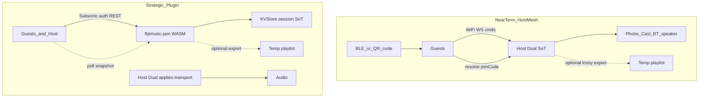

# Spotify Jam → FTP Music Local Party — Deep Implementation Dive

Status: Exploration / design (Collab · Jam · Blend still **product OOS** in
[`PLAYLIST_MANAGEMENT_BEHAVIOR_REPORT.md`](PLAYLIST_MANAGEMENT_BEHAVIOR_REPORT.md)
until explicitly reopened)  
Date: 2026-11-12  
Related: ADR-0010, ADR-0015, ADR-0067, ADR-0076, ADR-0111, ADR-0153,
[`PlayRestrictedPermissions.kt`](../compose/app/src/main/java/com/lucasdss/ftpmusic/app/PlayRestrictedPermissions.kt),
Navidrome plugins (v0.60+), draft [HTTPEndpoint #5045](https://github.com/navidrome/navidrome/pull/5045),
collab playlists draft [#5460](https://github.com/navidrome/navidrome/pull/5460)

---

## 1. Verdict

Spotify Jam is a **cloud-hosted shared listening session** with local
**invite wrappers** (BLE, same Wi‑Fi prompt, QR/link). Audio is either one
shared speaker (in-person) or per-device CDN playback clock-aligned (remote).

FTP Music can approximate **in-person host DJ / shared-speaker control** with:

1. **Near-term (no plugin):** **Host Dual + LAN WS = only control/queue SoT.**
   Guests send commands over Wi‑Fi; BLE/QR for invite. Optional **lossy**
   Navidrome playlist export (not recovery SoT — see §3 / §6).
2. **Strategic:** custom **`ftpmusic-jam` WASM plugin** holding revisioned
   session state in **KVStore**, exposed via `/rest/ext/ftpmusic-jam/*` once
   inbound **HTTPEndpoint** ships (#5045). App feature-detects; mesh and
   plugin must not both apply transport without a mutex.

**Playlist-only multi-writer Jam is blocked** on stock Navidrome: only the
playlist **owner** (or admin) may `updatePlaylist`. `public=true` = visibility,
not co-edit — and public export **leaks queue contents server-wide**.

**Hard rules (post-challenge):**

| Rule | Meaning |
|------|---------|
| Dual + WS Resync | Sole near-term queue/transport SoT |
| Playlist | Optional lossy export; never Remove/Move source |
| Cast | Guests never become Cast senders (product rule; ADR-0010 documents second-sender *staleness*, does not ban it) |
| Reconnect | Join uses short `joinCode` + host resolve endpoint; QR must not be the only locator after IP/port churn |

---

## 2. Spotify Jam — capability → interaction map

Sources: [Support – Start or join a Jam](https://support.spotify.com/us/article/jam/),
Newsroom 2023/2025/2026, patent-style group session model (cloud session state).

| Capability | Who | How users interact |
|------------|-----|--------------------|
| Start / host | Premium | Device picker / playlist ⋮ / speaker connect |
| Invite | Host | Link, QR, BLE ~1 m tap, same-Wi‑Fi prompt, Messages Request-to-Jam |
| Join in-person | Free or Premium | Same speaker; guests often no local audio |
| Join remote | Premium | Own device plays synced to session |
| Shared queue | All | Add via Search / Group Recommendations; see who queued |
| Reorder / remove | All (host can always) | Queue UI; host can kick tracks/people |
| Play / pause / skip | Guests if host allows | Host toggle “Let others change what’s playing” |
| Volume | Guests if host allows | Only Chromecast / Amazon Cast share; not BT / AirPlay |
| Leave | Guest | Leave or switch device |
| End | Host leave | Ends for everyone |
| Surfaces | — | Phone, desktop, TV, Android Auto, CarPlay |

**Systems note:** BT/Wi‑Fi are mostly **discovery**. Session SoT is **cloud**.
Shuffle-seed drift writeups imply guests reconcile to host/server “now playing.”

---

## 3. State ownership matrix (FTP Music)

| State | Near-term SoT | Optional export / later | Notes |
|-------|---------------|-------------------------|-------|
| Ordered queue track ids | Host Dual (`DualQueueManager`) | Lossy temp playlist export | Owner-only writes; **not** recovery SoT |
| `queueEntryId`, PRIORITY/LATE bands | Host Dual (`revision`) | Plugin KV only | Playlist **cannot** round-trip these |
| Now playing index + position | Host Exo/Cast | Optional `savePlayQueue` (host account) | `getPlayQueue` unused today |
| Play/pause | Host player | Mesh / plugin transport field | Not in playlist API |
| Members + display names | Host `PartySession` | Plugin KV / mesh welcome | Member id must survive reconnect |
| Guest permission toggles | Host session (persist in Room) | Plugin KV | |
| Join token / joinCode | Host RAM + Room; resolve HTTP | Plugin KV TTL | Playlist id alone ≠ control |
| Who queued | Dual metadata extension | Plugin queue items | No playlist comment API on client today |



---

## 4. Implement each Jam functionality (near-term + plugin)

Each subsection: **Spotify behavior → FTP Music behavior → how to build →
hooks → edge cases.**

### 4.1 Start a Party (host)

**Spotify:** Premium starts Jam on current device/speaker.

**FTP Music:** Any logged-in user with library access can host (no Premium
analogue). Entry points: Now Playing / Cast picker row / Queue sheet action
“Start Party”.

**How to implement:**

1. New `PartySessionController` (`@Singleton`) owned beside `PlaybackManager`.
2. Single-flight: reject if already hosting; idempotent `startParty()`.
3. `startParty()`:
   - Generate `sessionId` (UUID), `joinToken` (32+ bytes; store encrypted /
     plaintext needed for rebind — hash alone cannot re-auth guests), short
     `joinCode` (high-entropy; treat as secret-ish).
   - Snapshot Dual merged queue + entry metadata + `revision`.
   - **Bind LAN control server first** (Phase 1 stub can serve resolve +
     snapshot even before full guest cmds). If bind fails → abort; no orphan
     playlist.
   - Optional playlist export (default **off** or **private** until product
     accepts server-wide leak of `public=true`):
     `PlaylistRepository.createPlaylistWithTracksSynced(...)` — handle
     **null** failure; name `FTP Party $joinCode`. Client has **no comment**
     param on `updatePlaylist` today. Prefer **not** public by default.
   - Start FGS-compatible party notification (“Party active — tap to manage”)
     so WS survives UI kill; tie to `MediaService` or dedicated FGS type
     (design before ship — Android 14+).
   - Optional BLE advertise (Phase 3).
   - UI: party badge on mini-player / queue sheet.
4. Persist `PartyLocalEntity` (sessionId, playlistId?, token, joinCode, port,
   startedAt, permissions JSON). On restore: rebind port (may change) →
   guests must **re-resolve via joinCode** (see 4.2), not sticky QR IP:port.
5. Orphan GC: on start, delete stale `FTP Party *` playlists older than TTL
   owned by user; on crash, next start cleans.

**Hooks:**
`PlaybackManager`, `PlaylistRepository.createPlaylistWithTracksSynced`,
`setPlaylistPublic` (only if export+public opted in), playlist delete via
pending `"delete"` path (no `PlaylistRepository.deletePlaylist` today —
use same VM/worker path), `MediaService` logout → end party.

**Edges:** Offline host → mesh-only, no export. Cast active → same Dual; no
second queue. Guest local playback **locked** while in Party guest mode
(suppress idle Dual play from MediaSession).

---

### 4.2 Invite (QR, link, BLE, same-Wi‑Fi)

**Spotify:** QR, share link, BLE tap ~1 m, same-Wi‑Fi auto prompt, Messages.

**FTP Music (phased):**

| Path | Phase | Implementation |
|------|-------|----------------|
| QR | 1 | Versioned payload: `ftpmusic://party/join?v=1&code=<joinCode>&hintHost=<ip>&hintPort=<p>&playlist=<id?>` — **code is authoritative**; hints may go stale |
| Resolve | 1 | Host HTTP `GET /party/resolve?code=` returns current `{wsUrl, token, sessionId, playlistId?}` after PIN/token check — fixes DHCP/port churn |
| Share | 1 | Share joinCode + on-screen QR; playlist deep link only if export enabled (“view queue”, not control) |
| BLE | 3 | Advertise joinCode only; guest calls resolve on discovered/hint host |
| Same-Wi‑Fi auto prompt | Defer | Avoid `NEARBY_WIFI_DEVICES` while targetSdk 36 ([ADR-0153](adr/0153-local-network-permission-api-37.md)) |
| Messages Request-to-Jam | Out | No social graph |

**Address selection:** prefer non-VPN IPv4 private ranges for `hintHost`; show
manual IP if join fails (AP client isolation common — UX must say “same network
must allow device-to-device”).

**BLE how-to:** `BLUETOOTH_ADVERTISE` / `SCAN` / `CONNECT` only. Document Play
Nearby-devices scrutiny even without `NEARBY_WIFI_DEVICES`. Existing A2DP
resume code stays orthogonal.

---

### 4.3 Join (guest)

**Spotify:** Accept invite; choose in-person vs remote (Premium).

**FTP Music MVP:** **In-person controller only** (guest hears host speaker; no
local synced audio). Remote multi-device A/V sync = later research.

**How to implement:**

1. Deep link / QR parser → `PartyJoinViewModel`.
2. Preconditions: app has **same Navidrome server** configured (compare
   normalized base URL). If mismatch → error “Same server required”.
3. `getPlaylist(playlistId)` → render initial queue (read path works for
   public playlists).
4. Open WebSocket `ws://host:port/party?token=…` (or `wss` if we terminate TLS —
   LAN cleartext OK only on private ranges; document threat).
5. On `Welcome`: store revision, permissions, members; switch UI to Party mode
   (queue mirror + search add).
6. Guest Dual is **not** SoT; local player stays idle / paused unless future
   remote mode.

**Plugin mode:** `POST /rest/ext/ftpmusic-jam/sessions/{id}/join` with Subsonic
auth; poll `GET …/sessions/{id}` — no host LAN required if server reachable
(enables remote control over internet while host still plays audio at home).

---

### 4.4 Shared queue — add tracks

**Spotify:** Search or Group Recommendations; attribution who added.

**FTP Music:**

1. Guest Search (existing) → “Add to Party” → WS `Add(trackId, title, artist,
   coverId)`.
2. Host validates track exists (Room/`getSong`/library); rejects unknown ids.
3. Host `PlaybackManager` add-to-queue (PRIORITY or end-of-CONTEXT — product
   pick: **end of CONTEXT** default; “Play next” if guest allowed).
4. Annotate entry with `queuedBy: displayName` (extend Dual entry / journal).
5. Debounced playlist mirror: `updatePlaylist(songIdToAdd = …)`.
6. Broadcast `Delta(revision++)` to all guests.

**Group Recommendations:** defer (needs taste overlap model). Phase stub: “From
host’s Daily Mix / radio” chips using existing recommendation surfaces.

**Plugin:** any member `POST …/queue {op:add, trackId}`; plugin validates via
SubsonicAPI; host device polls and applies to Dual when it is the designated
playback node.

---

### 4.5 See who queued what

**Implement:** `QueueEntry` / UI row subtitle `Added by Alex`. Persist in Room
queue extras if we want history after party; else session-only map
`entryId → memberId`.

Playlist mirror cannot store per-track attribution without abusing track order
+ side channel — prefer mesh/plugin metadata.

---

### 4.6 Reorder / remove queue items

**Host:** always allowed via existing queue sheet → Dual → mirror
`songIndexToRemove` / full replace on heavy reorder (`sync_tracks` pattern in
`PlaylistSyncWorker`).

**Guest:** if `guestsCanReorder`; else host-only. WS `Move` / `Remove` with
`entryId` (stable Dual ids — do not use playlist index alone across races).

**Debounce:** coalesce rapid guest adds (300–1000 ms) before Navidrome
`updatePlaylist` to avoid GET URL length / storm (see sync consistency report;
`formPost` still deferred).

---

### 4.7 Play / pause / skip (transport)

**Spotify:** gated by “Let others change what’s playing”.

**FTP Music:**

| Cmd | Host | Guest (if allowed) |
|-----|------|--------------------|
| Play/Pause | `PlaybackManager` / MediaSession | WS → host |
| Skip next/prev | Same | WS → host |
| Seek | Same | Optional; default host-only |

When guest controls **off**: guests queue-only (Spotify parity).

**Cast concurrency fence (P0):**

- All party mutations enqueue on one host serial mutator (same as Dual writes).
- While ADR-0010 **remote→local Cast resync** runs, pause applying guest cmds
  or buffer until resync generation completes — then WS `Resync` to guests.
- Broadcast `Delta` only after local Dual commit; if Cast optimistic ack fails
  ([ADR-0111](adr/0111-cast-cp-batch-ack-and-source-circuit.md)), rollback Dual
  and `Reject`/`Delta` correction — do not leave guests on speculative success.
- Product rule: guests never become Cast senders (ADR-0010 explains staleness
  from second senders; party design forbids creating that situation).

---

### 4.8 Volume

**Spotify:** separate toggle; shared only on Chromecast / Amazon Cast.

**FTP Music:**

- Local / BT speaker: **host-only** volume (system / A2DP).
- Cast: optional guest WS `SetVolume` → host Cast volume APIs if already
  exposed; else host-only.
- Document honestly in UI (no fake shared volume on BT).

---

### 4.9 Host permission toggles

Session flags (host UI sheet):

- `guestsCanControlPlayback` (default true for party feel; false for DJ booth)
- `guestsCanReorder` (default true)
- `guestsCanSkip` (can fold into playback)
- Broadcast `PermissionsChanged` on WS / store in plugin KV

---

### 4.10 Member list — add / remove / kick

- Host UI: members from WS join events.
- Kick: `RemoveMember(id)` → close that socket; optional ban token hash for
  session.
- Remove all: Spotify parity button.
- Guest leave: `Leave` or disconnect; host updates roster.

---

### 4.11 Leave / end party

| Event | Behavior |
|-------|----------|
| Guest leave | Drop from roster; queue unchanged |
| Host leave / End | Close WS; stop BLE; `deletePlaylist(tempId)` or unpublic+rename `Archive …`; clear PartyLocalEntity; toast guests “Party ended” |
| Host process death | On restore: if playlist still exists + Room party row fresh (&lt; TTL), rebind; else end |
| MediaService destroy / logout | End party |

---

### 4.12 Auto-start on speaker connect (Spotify tip)

**Defer.** Spotify auto-starts Jam on many BT/smart speakers. FTP Music could
later offer setting “Offer Party when Casting” — not default (surprise social
surface).

---

### 4.13 Car / TV / Android Auto

**Phase later.** Pattern: host session on phone; Auto shows queue + Jam QR
notification; guests join from phones (Spotify Auto/CarPlay model). Reuse
MediaSession browse; do not invent second queue.

---

### 4.14 Listening Activity / Request to Jam (Messages)

**Out of scope** — no Messages social graph. Closest future: LAN presence
beacon (privacy-sensitive; defer).

---

## 5. Wi‑Fi control plane (protocol)

### 5.1 Transport

- Host: Netty or Ktor CIO — **HTTP resolve + snapshot** and **WebSocket** on
  same ephemeral port while party active. Do **not** casually copy
  `PlaybackProxy` unauthenticated `0.0.0.0` Cast-cache policy; party needs
  token/PIN on every route.
- Auth: joinCode → resolve returns short-lived ws token; optional party PIN;
  rotate token on host restore; rate-limit joins/resolve.
- Protocol version in `Welcome`; heartbeat timeout ⇒ Leave.
- Commands: idempotent `clientTag`; max members / max queue size enforced.
- Cleartext `ws://` only on private LAN ranges; document MITM risk; PIN
  required for non-hotspot hostile LAN product default recommendation.
- Hotspot: host shows joinCode + refreshable QR after rebind.

### 5.2 Message schema (JSON sketch)

```text
Welcome { revision, playlistId, sessionId, permissions, members[], queue: QueueItem[] }
Add { trackId, clientTag? }
Remove { entryId }
Move { entryId, toIndex }
Skip { direction: next|prev }
Pause | Play | Seek { positionMs }
SetPermissions { ... }          // host only
Kick { memberId }               // host only
Delta { revision, changes[] }   // server→clients
Reject { reason, clientTag? }
Heartbeat
```

**Revision:** monotonic int; guests ignore stale deltas; can request
`Resync` → full snapshot (same idea as Cast ack / Dual generation).

### 5.3 Latency budget

| Path | Target |
|------|--------|
| Guest Add → host Dual UI | &lt; 100 ms LAN |
| Host → guest Delta | &lt; 100 ms |
| Playlist mirror | 300–1000 ms debounce |
| Plugin poll snapshot | 500 ms–2 s |

---

## 6. Navidrome temp playlist — optional lossy export

### 6.1 Role (downgraded post-challenge)

| Use | OK? |
|-----|-----|
| Human-visible queue in web UI | Optional |
| Deep link “view queue” ([ADR-0076](adr/0076-queue-sheet-sleep-repeat-and-share-publish.md)) | Optional |
| Late join **hint** | Prefer WS `Welcome` / `GET /party/snapshot` instead |
| Recovery if mesh flaps | **No** — use Dual + WS `Resync` |
| Multi-writer control | **No** — owner-only |

Default: **export off**. If on, prefer **private** playlist (host-only) unless
product explicitly accepts public leak on shared servers.

### 6.2 Why not enough alone

- Owner-only `updatePlaylist`
- No pause/position/members/entry ids/PRIORITY bands
- `PlaylistSyncWorker` 15 s interval is **outbound flush** cadence, not a
  guest poll loop — either way too coarse for DJ control
- Concurrent same-account writers = last flush wins
- Direct `updatePlaylist` during party needs an **ADR-0015 exception** (bypass
  or dedicated mirror path); `addToPlaylist` dedupes and drops band semantics

### 6.3 Mirror algorithm (host, if export enabled)

```text
on Dual mutation during party:
  schedule MirrorJob(debounce 500ms)
MirrorJob:
  track lastMirroredTrackIds (lossy list only)
  prefer incremental songIdToAdd / songIndexToRemove via SubsonicApi
  heavy reorder → full replace; watch URL length / formPost deferral
  lastMirrorRevision = Dual.revision   // display/debug only; never overrides Dual
```

On party end: pending `"delete"` change (same as library delete). Crash:
orphan GC on next `startParty`.

### 6.4 `savePlayQueue` / `getPlayQueue`

Host `savePlayQueue` stays personal. `getPlayQueue` optional Phase 4
same-account experiment — **not** Party SoT.

---

## 7. Navidrome plugin `ftpmusic-jam` — how to implement

### 7.1 Feasibility

| Building block | Status | Use |
|----------------|--------|-----|
| WASM plugin + KVStore + TTL | Shipped v0.60+ | Session SoT |
| Scheduler | Shipped | Expire idle sessions |
| SubsonicAPI host | Shipped | Validate tracks; optional playlist mirror |
| Outbound HTTP/WS | Shipped | External only |
| **Inbound HTTPEndpoint** `/rest/ext/{id}/*` | **Draft #5045** | **Required for clients** |

**Today:** cannot ship plugin-backed Jam API on stock release without sidecar or
waiting for #5045.  
**Design the API now** so app + plugin share one contract.

### 7.2 Manifest sketch

```json
{
  "name": "FTP Music Jam",
  "author": "FTP Music",
  "version": "0.1.0",
  "description": "Revisioned collaborative listening sessions",
  "permissions": {
    "kvstore": { "reason": "Store jam sessions", "maxSize": "8MB" },
    "scheduler": { "reason": "Expire idle jams" },
    "subsonicapi": { "reason": "Validate tracks and mirror playlists" },
    "users": { "reason": "Authorize jam participants" },
    "endpoints": { "auth": "subsonic", "reason": "Jam REST for Subsonic clients" }
  }
}
```

### 7.3 REST contract (when endpoints exist)

| Method | Path | Actor | Behavior |
|--------|------|-------|----------|
| POST | `/rest/ext/ftpmusic-jam/sessions` | Host | Create session; seed queue; return id+code |
| POST | `/rest/ext/ftpmusic-jam/sessions/{id}/join` | Guest | Add member |
| GET | `/rest/ext/ftpmusic-jam/sessions/{id}` | Member | Snapshot by revision |
| POST | `/rest/ext/ftpmusic-jam/sessions/{id}/queue` | Member | add/remove/move |
| POST | `/rest/ext/ftpmusic-jam/sessions/{id}/transport` | Permitted | play/pause/skip/seek |
| PATCH | `/rest/ext/ftpmusic-jam/sessions/{id}/permissions` | Host | Toggles |
| DELETE | `/rest/ext/ftpmusic-jam/sessions/{id}` | Host | End + cleanup |

KV keys: `jam:{id}`, `jam:{id}:rev`, `code:{short}→id`. TTL refresh on activity.

### 7.4 Host device role with plugin

Plugin holds **control SoT**; **playback node** (host phone) still applies
transport to Dual/Cast. Host polls snapshot or receives optional future push.
Guests never become Cast senders.

### 7.5 Sidecar fallback

If #5045 stalls: small Go/Kotlin service beside Navidrome implementing the same
REST paths, authenticating via Subsonic token validate proxy. Ops cost higher;
same app feature detection (`OPTIONS` or well-known URL).

---

## 8. Android app module sketch (when OOS reopened)

```text
party/
  PartySessionController.kt      // host lifecycle
  PartyGuestClient.kt             // WS + plugin REST
  PartyTransport.kt               // bind server / messages
  PartyInvite.kt                  // QR + BLE
  PartyPlaylistMirror.kt          // debounce Navidrome
  ui/PartySheet.kt                // members, permissions, QR
```

Feature flag: `party_local_enabled` (default off until OOS reopen + QA).

Detect plugin:

```text
GET /rest/ext/ftpmusic-jam/sessions?…  // or dedicated health
→ if 404/501: mesh mode only
→ if 200/401 with plugin header: server mode available
```

---

## 9. Security & Play policy

- Join token required for control; public playlist id is read-only bootstrap.
- Bind WS to party lifetime; no persistent `0.0.0.0` service.
- Do not ship guest shared host passwords.
- Review plugin permissions in Navidrome admin UI.
- Stay clear of forbidden manifest perms under target 36
  (`NEARBY_WIFI_DEVICES`, `ACCESS_LOCAL_NETWORK`, …).
- Rate-limit WS commands and plugin endpoints (draft ~60/min — raise for Jam or
  use deltas sparingly).

---

## 10. Testing strategy (when building)

| Layer | Tests |
|-------|-------|
| Protocol | Unit: revision apply, reject stale, permission gates |
| Mirror | Unit: incremental vs full replace; debounce |
| Host integration | Dual mutation → mirror → getPlaylist equals |
| Guest UI | Fake WS fixture; add appears with attribution |
| Cast | Party skip while casting uses Cast executor; no dual sender |
| Process death | Host restore / guest reconnect |
| Plugin | WASM unit + Subsonic auth integration against Navidrome test |

Coverage bar per android-feature-loop: ≥80% on new `party` packages.

---

## 11. Phased roadmap

| Phase | Deliverable | Depends |
|-------|-------------|---------|
| 0 | This doc (+ challenge rework) | — |
| 1 | Host start/end + WS bind + resolve/snapshot + QR(code) + FGS note; playlist export **off** by default | OOS reopen + ADR |
| 2 | LAN WS guests (add/transport/permissions); Cast fence; guest playback lock | Phase 1 |
| 3 | BLE invite | Phase 2 |
| 4 | Optional private playlist export; `getPlayQueue` experiment; Cast volume | Phase 2 |
| 5 | `ftpmusic-jam` plugin + app server mode (mutex vs mesh) | #5045 merged |
| C | Guest-direct playlist edits | Navidrome #5460 |

---

## 12. FTP Music gap vs Spotify (summary)

| Spotify | FTP Music today | After Local Party |
|---------|-----------------|-------------------|
| Cloud session | None | Host mesh ± plugin KV |
| Multi-user queue write | OOS; public playlist read | Guest→host→playlist / plugin |
| BLE / Wi‑Fi invite | A2DP only; Cast discovery | QR + BLE; Wi‑Fi control |
| Remote synced listen | No | Defer (hard) |
| Group recommendations | Daily Mix personal | Defer |
| Cast multi-guest | Single sender | Host-only Cast + guest cmds |

Closest shipped: Cast queue sync, queue→public playlist share (ADR-0076),
MediaSession remote of **same** session.

---

## 13. Open decisions (product, before code)

1. Reopen Collab OOS for **Local Party** only (not Blend)?
2. Default guest playback control on or off?
3. Require same Navidrome account library visibility vs public playlist only?
4. Invest in plugin (#5045 wait) vs mesh-first ship?

---

## 14. Cross-model challenge log

Performed 2026-11-12 (DeepSeek-style audit + Mistral-style challenge). Doc
reworked for P0s below. **Not an implement Approved** — exploration baseline
after rework.

### 14.1 Audit findings (accepted)

- ADR-0010 overclaim fixed → product no-second-sender rule.
- 15 s worker = outbound flush, not guest poll — corrected in §6.
- No `PlaylistRepository.deletePlaylist` / no comment param — hooks updated.
- Dual field is `revision`, not `dualGeneration`.
- Phase 1 must include resolve/snapshot WS bind; QR code-authoritative.
- Party mirror needs ADR-0015 exception if export enabled.
- FGS/Doze/process-death + Cast↔Party fence required before ship.

### 14.2 Challenge findings (accepted P0s)

1. Temp playlist is **not** recovery SoT → Dual + WS Resync only.
2. Stable join via **joinCode resolve** (IP/port churn).
3. `public=true` privacy leak → export default off / private.
4. Cast resync ↔ party mutation concurrency fence.
5. Cleartext token/QR mitigations (PIN/TTL) as requirements, not footnotes.
6. Guest MediaSession playback lock in guest mode.
7. Orphan playlist GC on start/end/crash paths.

### 14.3 Residuals (P1 — track in implement ADR)

- Guest without Navidrome account funnel (host search proxy).
- Library ACL mismatch host vs guest.
- API 37 `ACCESS_LOCAL_NETWORK` trajectory for LAN WS.
- Mesh + plugin dual-applier mutex when Phase 5 lands.
- Member identity across reconnect; command idempotency (`clientTag`).
- Remote multi-ear A/V sync still deferred.

**Verdict:** Exploration deliverable **usable after rework**. Implement pass
still blocked on product OOS reopen + party ADR.

---

## 15. Exit criteria for a future implement pass

- [ ] Product reopens Local Party scope
- [ ] ADR accepted (mesh-first + plugin feature detect)
- [ ] Phase 1–2 code + unit tests ≥80% party package
- [ ] `assembleDebug` green; ktlint
- [ ] Manual two-device LAN test: add/skip/kick/end + playlist deleted
- [ ] Cast-in-party skip test
- [ ] Phase-5 style audit + challenge on the PR/diff
